<picture>
  <source media="(prefers-color-scheme: dark)" srcset="assets/banner-dark.svg">
  
</picture>

<h1 align="center">🔪 暖島清算日 COZY ISLE: PAYBACK</h1>

<p align="center"><b>可愛島民 × 誇張武器 × 卡通血腥，打開瀏覽器就能玩的第一人稱紓壓遊戲</b></p>

<p align="center">
  
  
  
  
</p>

<p align="center">
  <a href="#-這遊戲在幹嘛">這遊戲在幹嘛</a> •
  <a href="#-怎麼開始玩">怎麼開始玩</a> •
  <a href="#-十把武器">武器</a> •
  <a href="#-禮物箱與-35-種絕招">絕招</a> •
  <a href="#-怎麼做出來的">怎麼做的</a> •
  <a href="#-常見問題">常見問題</a>
</p>

**暖島清算日**是一款 3 分鐘就能玩完一局的網頁小遊戲：你拿著武士刀、巨大槌子、火焰噴射器，在一座可愛小島上追著島民跑。島民不會還手，只會一邊逃一邊講「需求又改囉～」「我電腦上是好的」這種讓人血壓上升的話。被案子追了一整天之後，打開它發洩一下，免安裝、免帳號。

<p align="center"><b>👉 <a href="https://nanhong-byte.github.io/cozy-isle-payback/">點這裡直接玩</a></b></p>

<p align="center">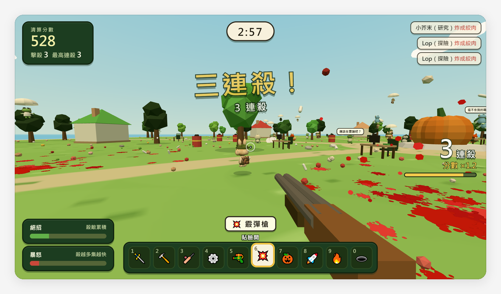</p>

<!-- 🎬 影片位：30 秒實機錄影（真人用滑鼠玩，含連殺、雷雨、一招絕招）。上架時在 GitHub 網頁編輯器把 mp4 拖進這一行 -->

> [!NOTE]
> 這是卡通風格的血腥遊戲，島民全部是 AI 做的 3D 模型，沒有任何動物（或同事）在製作過程中受傷。不適合小朋友，也不建議在客戶面前打開。

## 📌 目錄

- [這遊戲在幹嘛](#-這遊戲在幹嘛)
- [怎麼開始玩](#-怎麼開始玩)
- [操作方式](#-操作方式)
- [十把武器](#-十把武器)
- [追殺對象](#-追殺對象)
- [兩種模式與計分](#-兩種模式與計分)
- [排行榜、稱號與防沉迷](#-排行榜稱號與防沉迷)
- [打久了會變天](#-打久了會變天)
- [禮物箱與 35 種絕招](#-禮物箱與-35-種絕招)
- [慘叫版](#-慘叫版)
- [彩蛋](#-彩蛋)
- [怎麼做出來的](#-怎麼做出來的)
- [常見問題](#-常見問題)
- [還沒做好的地方](#-還沒做好的地方)

## ✨ 這遊戲在幹嘛

一句話：**用最誇張的方法，把最欠揍的島民處理掉。** 你不會死，島民不會反擊，沒有任何需要動腦的地方。

| | 內容 | 白話說 |
|---|---|---|
| 🔪 | 十把武器 | 每把都有自己專屬的死法，不是換個外觀而已 |
| 🐾 | 十種島民 | 各有職稱和口頭禪，場上最多同時 72 隻 |
| 🎁 | 35 種絕招 | 變身怪獸、開跑車、氣功波、大飛碟、年終獎金鯨魚 |
| 🌧️ | 會變天 | 打到 1 分鐘開始下雨，2 分鐘轉雷雨，雷會幫你劈 |
| 😱 | 慘叫版 | 每種死法配一種叫聲，可以關 |
| 🏆 | 連殺與評等 | 連殺有倍率，結算給 D 到 SSS |
| 🎖️ | 排行榜與稱號 | 從工單群島開就上全公司排行榜，依玩法給稱號 |

<p align="center">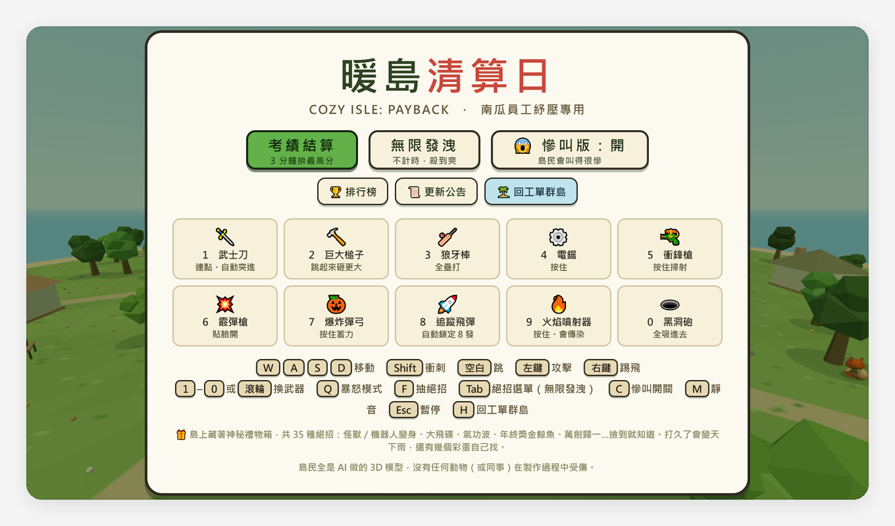</p>

## 🚀 怎麼開始玩

兩種方式，挑一個。

### 方式一：線上玩（最快）

1. 用電腦的 Chrome 或 Edge 打開 <https://nanhong-byte.github.io/cozy-isle-payback/>。
2. 等進度條跑完。第一次要下載約 4.6 MB，之後就很快。
3. 點「考績結算」或「無限發洩」，再點一下畫面讓滑鼠鎖進遊戲。

做對的話，你會看到手上拿著武士刀，畫面上方出現「清算開始！」。

### 方式二：下載回來離線玩

1. 點這頁右上的綠色 **Code** 按鈕 → **Download ZIP**，解壓縮。
2. 雙擊資料夾裡的 `開始遊戲.cmd`（或直接雙擊 `dist/index.html`）。

不需要安裝任何東西，也不需要網路。要分給同事，把整個 `dist` 資料夾（約 11 MB）傳過去就好。

> [!TIP]
> 想一次試完所有絕招，進「無限發洩」模式後按 <kbd>Tab</kbd>，35 招想玩哪個直接點。

## 🎮 操作方式

需要鍵盤和滑鼠，手機和平板目前不能玩。

| 按鍵 | 動作 |
|---|---|
| <kbd>W</kbd> <kbd>A</kbd> <kbd>S</kbd> <kbd>D</kbd> | 移動 |
| 滑鼠 | 轉視角 |
| 左鍵 | 攻擊（多數武器可以按住） |
| 右鍵 | 踢飛，撞到樹或房子會直接炸在上面 |
| <kbd>Shift</kbd> | 衝刺 |
| <kbd>空白鍵</kbd> | 跳 |
| <kbd>1</kbd>–<kbd>0</kbd> 或滾輪 | 換武器 |
| <kbd>Q</kbd> | 暴怒模式（量表集滿才能開） |
| <kbd>F</kbd> | 抽一招絕招（絕招槽集滿才能抽） |
| <kbd>Tab</kbd> | 絕招選單（只有無限發洩模式） |
| <kbd>C</kbd> | 慘叫版開關 |
| <kbd>M</kbd> | 靜音 |
| <kbd>Esc</kbd> | 暫停（暫停畫面可以回工單群島） |
| <kbd>H</kbd> | 直接回南瓜工單群島 |

## 🔪 十把武器

每把武器的重點不是傷害數字，而是「島民會怎麼死」。全部無限彈藥。

| 鍵 | 武器 | 用法 | 死法 |
|:---:|---|---|---|
| 1 | 🗡️ 武士刀 | 連點，離太遠會自動突進 | 攔腰或斜切兩半，下半身還會繼續跑 |
| 2 | 🔨 巨大槌子 | 跳起來砸範圍更大 | 拍成肉餅，周圍的被震飛 |
| 3 | 🏏 狼牙棒 | 揮下去就是全壘打 | 飛上天變星星，途中撞到誰誰爆 |
| 4 | ⚙️ 電鋸 | 按住往前推 | 直劈兩半，血噴滿螢幕 |
| 5 | 🔫 衝鋒槍 | 按住掃射 | 爆頭後無頭身體亂跑 |
| 6 | 💥 霰彈槍 | 貼臉開 | 近距離炸成肉塊 |
| 7 | 🎃 爆炸彈弓 | 按住蓄力 | 爆炸南瓜，炸完再分裂 5 顆 |
| 8 | 🚀 追蹤飛彈 | 自動鎖定 | 一次鎖 8 隻 |
| 9 | 🔥 火焰噴射器 | 按住噴 | 著火亂跑、會傳染，最後變焦炭 |
| 0 | 🕳️ 黑洞砲 | 7 秒充能一發 | 全吸進去，再噴成血煙火 |

<p align="center">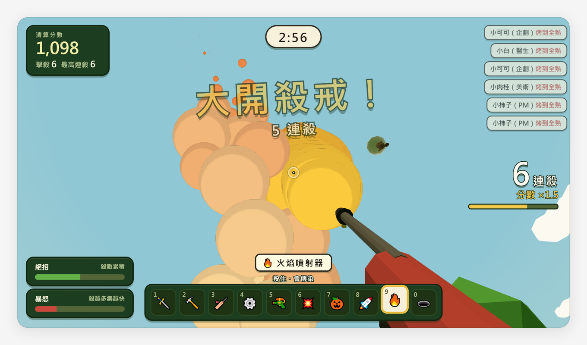</p>

場上還有 14 個瓦斯桶，打到會爆炸並連鎖引爆。爆炸不會傷到你，但會把你炸飛，可以拿來當跳板。

## 🐾 追殺對象

十種島民各有職稱和口頭禪，還有一點點個性差異。

| 島民 | 動物 | 職稱 | 特色 | 口頭禪 |
|---|---|---|---|---|
| 小柿子 | 狐狸 | PM | 最常見 | 「需求又改囉～」 |
| 小抹茶 | 變色龍 | 盤點 | 離遠一點會變半透明 | 「我已讀了」 |
| 小肉桂 | 小鹿 | 美術 | 跑最快 | 「我要五彩斑斕的黑」 |
| 小可可 | 貓頭鷹 | 企劃 | 跑最慢但血厚 | 「我們先開個會」 |
| 小栗子 | 河狸 | 工程 | 中規中矩 | 「我電腦上是好的」 |
| 小薄荷 | 蜂鳥 | 排程 | 會飛，要往上瞄 | 「臨時插個單～」 |
| 小麻糬 | 機器人 | QA | 血最厚，死了噴零件和機油 | 「這不是 bug 是 feature」 |
| 小芥末 | 青蛙 | 研究 | 用跳的 | 「上線前想再改一下」 |
| 小白 | 企鵝 | 醫生 | 搖搖晃晃 | 「多喝水就好」 |
| Lop | 兔子 | 探險 | 一次出現三隻 | 「+1」 |

每殺 25–30 隻會出現一隻**巨大化的島民**，有血條、會把你撞飛，打死有 3000 分還會掉一箱禮物。

## 🏆 兩種模式與計分

- **考績結算**：限時 3 分鐘，結束時依分數給評等，會記住這台電腦的最高分。
- **無限發洩**：不計時、不結算，按 <kbd>Tab</kbd> 可以任選絕招。

分數的算法很單純：每隻 100 分，加上特殊擊殺的加分，再乘上連殺倍率。

| 加分項目 | 分數 | 怎麼拿 |
|---|---:|---|
| 爆頭 | +60 | 用槍打頭 |
| 空中擊殺 | +120 | 目標在半空中時打死 |
| 撞牆 | +150 | 踢飛或炸飛後撞到樹、房子 |
| 餵鯊魚 | +150 | 打飛到海裡 |
| 保齡球 | +200 | 全壘打飛出去的島民撞死另一隻 |
| 天打雷劈 | +100 | 被雷劈死 |
| 金色島民 | +1500 | 見彩蛋 |

連殺每多一隻倍率加 0.1，最高 5 倍；3.2 秒內沒殺到下一隻就歸零。殺得夠多，左下角的暴怒量表會集滿，按 <kbd>Q</kbd> 進入 10 秒暴怒模式：全場慢動作、你的攻速加倍。

<p align="center">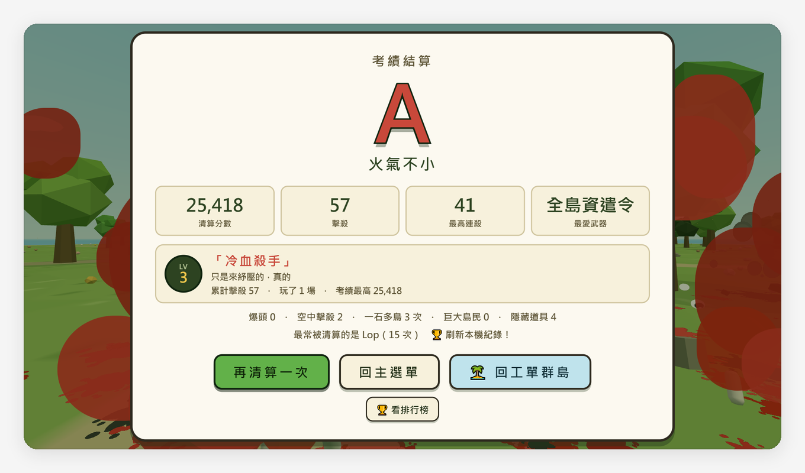</p>

<details>
<summary><b>評等門檻</b></summary>

| 評等 | 分數 | 稱號 |
|:---:|---:|---|
| SSS | 60,000 | 人資看了都怕 |
| SS | 42,000 | 暖島屠夫 |
| S | 28,000 | 清算大師 |
| A | 18,000 | 火氣不小 |
| B | 10,000 | 有在發洩 |
| C | 4,000 | 還在暖身 |
| D | 0 | 你是不是太善良了 |

門檻是 v1.0 定的，後來加了絕招之後分數變好拿很多，還沒重新調整。
</details>

## 🎖️ 排行榜、稱號與防沉迷

**從南瓜工單群島的「放鬆小島」打開**，每一局的成績會用公司帳號記下來，排上全公司排行榜；直接開網址玩的話，只記在這台電腦。

- **等級**：看累計擊殺數，殺越多等級越高（12 隻升 2 級、48 隻升 3 級，越後面越難升）。
- **稱號**：看你怎麼玩來決定，例如「屠夫」「冷血殺手」「AKA SSS 殺人魔」「賽車高手」「超級賽亞人」「折磨大師」「智能殺手」「不是人」「魔王」，排行榜第一名是「究極殺人王」。
- **一句描述**：依最愛武器給，例如用電鋸的會是「我是電鋸控，鮮血就是我的潤滑油」，用黑洞砲的是「宇宙大法師，黑洞就是拿來這樣玩的」。

> [!NOTE]
> **防沉迷**：連玩兩場還想開第三場（無限發洩每 3 分鐘算一場），會跳出「Yo Bro, 發洩完了吧~ 你該回島上囉」，30 分鐘內不能再開新局，工單群島的「開始玩」按鈕也會一起倒數。

<p align="center">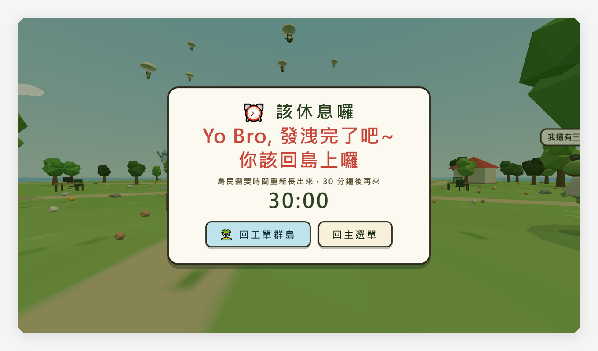</p>

隨時都能回工單群島：暫停畫面、結算畫面、主選單都有「🏝️ 回工單群島」，遊戲中按 <kbd>H</kbd> 也行。主選單另有「📜 更新公告」，記錄每一版加了什麼。

<p align="center">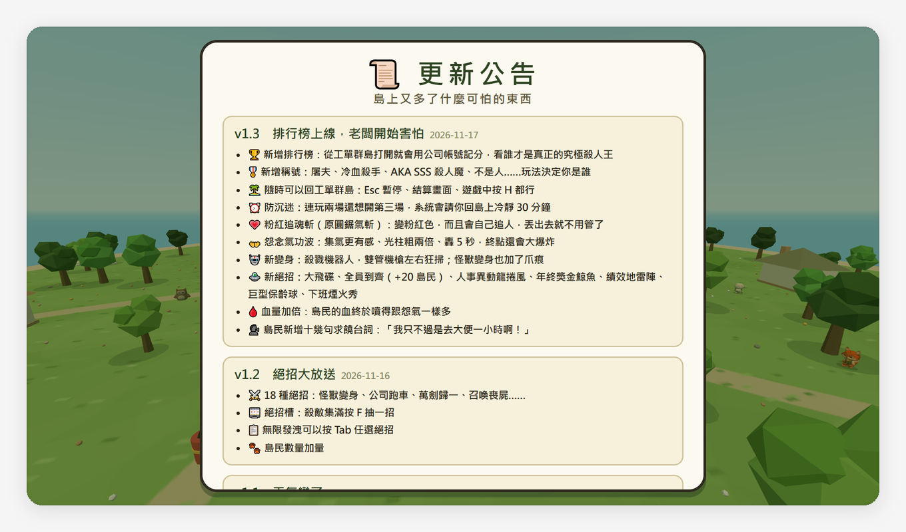</p>

## 🌧️ 打久了會變天

天氣會跟著時間走，而且會影響戰況。

| 時間 | 天氣 | 影響 |
|---|---|---|
| 0:00 起 | 晴天 | 沒有 |
| 1:00 起 | 下雨 | 天色變暗、起霧；地板濕滑，逃跑的島民會自己跌倒 |
| 2:00 起 | 雷雨 | 每 3.5–7 秒一道雷，劈中的直接變焦炭，還會往旁邊連鎖導電、引爆瓦斯桶 |

被雷劈死的都算你的分數。無限發洩模式每 5 分鐘循環一次，會放晴再下。

<p align="center">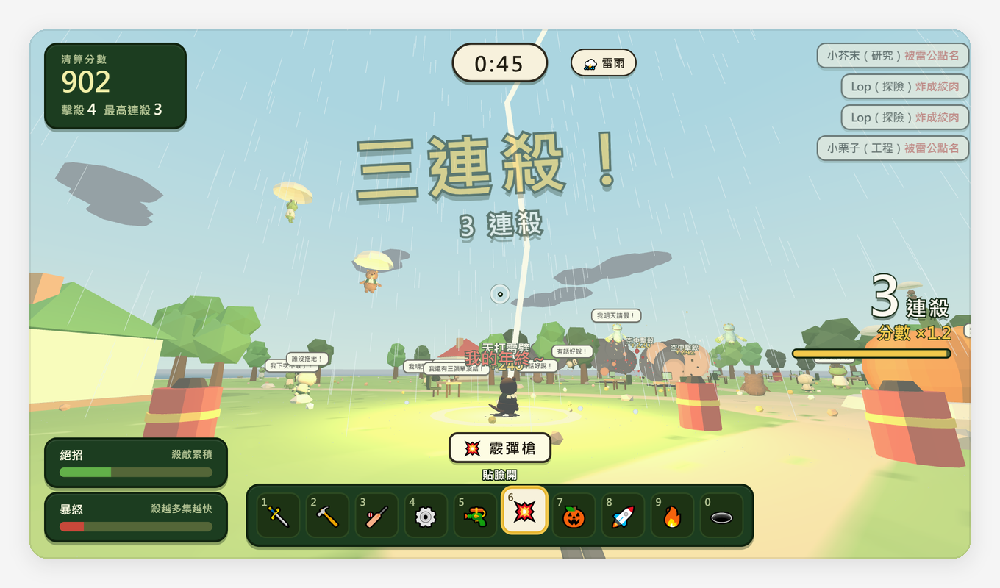</p>

> [!WARNING]
> 雷雨、核彈類的絕招會有全螢幕閃光。對閃光敏感的人請留意。

## 🎁 禮物箱與 35 種絕招

絕招是這遊戲最胡鬧的部分。拿到的方法有三種：

1. **撿禮物箱**：每 13–19 秒空投一箱，有金色光柱，走過去就撿。開局另外藏了三箱，沒有提示。
2. **絕招槽**：左下角那條，殺敵會累積，集滿按 <kbd>F</kbd> 隨機抽一招。
3. **絕招選單**：無限發洩模式按 <kbd>Tab</kbd>，直接點想玩的。

<p align="center">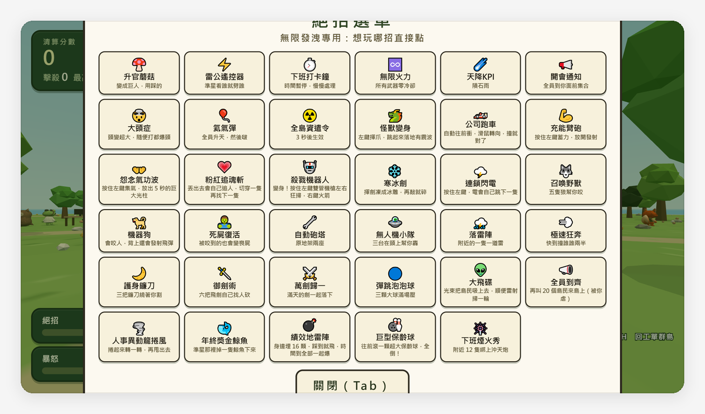</p>

### 最新加入的八招

| 絕招 | 效果 |
|---|---|
| 🤖 殺戮機器人 | 變身，按住左鍵雙管機槍左右狂掃，右鍵發射火箭 |
| 👽 大飛碟 | 光束把島民吸上去攪碎，順便用雷射掃一輪 |
| 📣 全員到齊 | 再叫 20 個島民空降到島上 |
| 🌪️ 人事異動龍捲風 | 自己找人群，捲起來轉幾圈再甩出去 |
| 🐋 年終獎金鯨魚 | 準星那裡掉一隻鯨魚下來，壓扁一片 |
| 💣 績效地雷陣 | 身邊埋 16 顆，踩到就飛，時間到剩下的連環爆 |
| 🎳 巨型保齡球 | 往前滾一顆超大保齡球，全倒！ |
| 🎆 下班煙火秀 | 附近 12 隻綁上沖天炮，升天變煙火 |

另外「粉紅追魂斬」丟出去會自己追人，「怨念氣功波」集氣後放 5 秒的粗光柱、終點大爆炸。

<p align="center">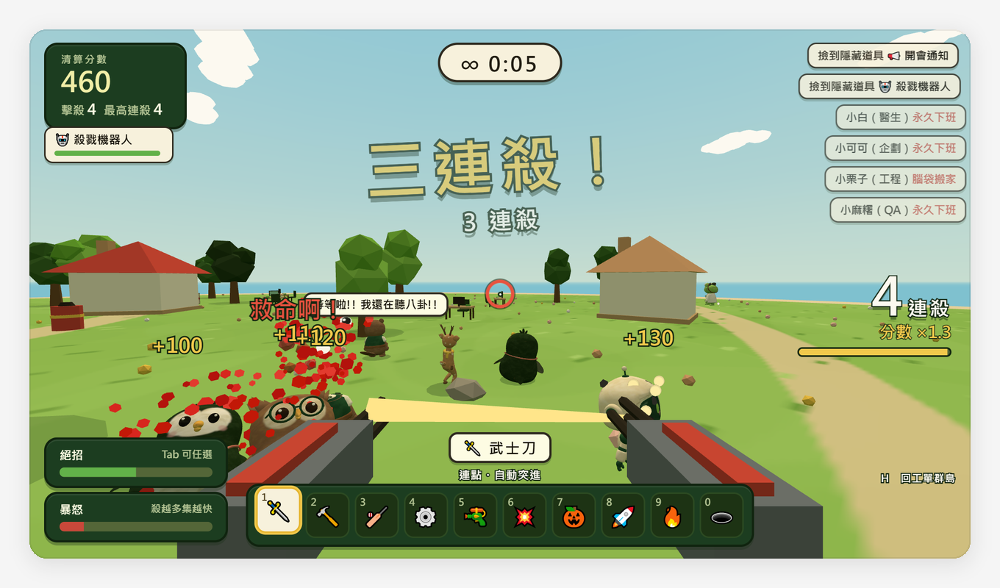</p>

<p align="center">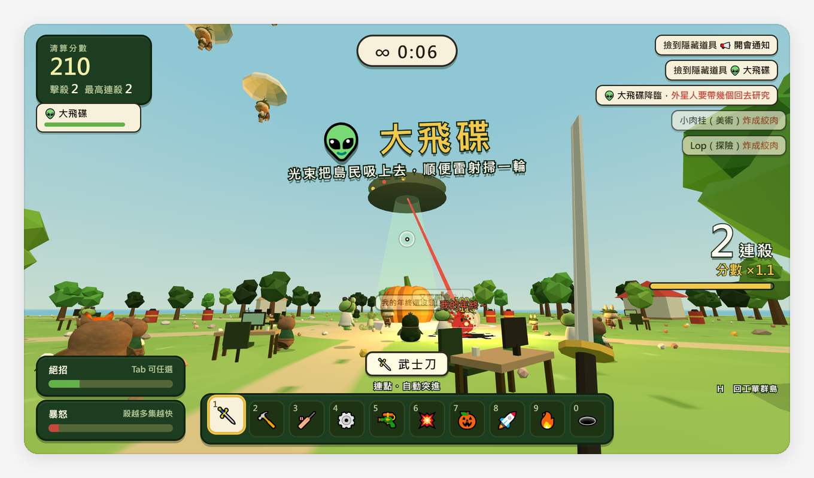</p>

<table><tr>
<td>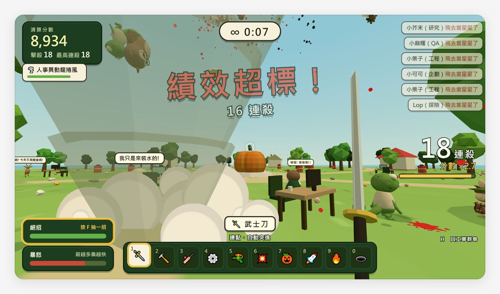</td>
<td>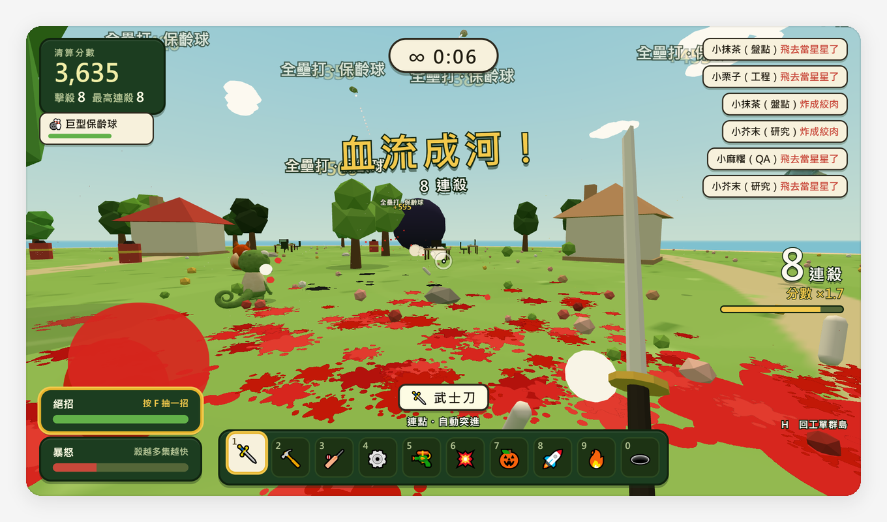</td>
</tr><tr>
<td align="center">🌪️ 人事異動龍捲風</td><td align="center">🎳 巨型保齡球</td>
</tr></table>

<p align="center">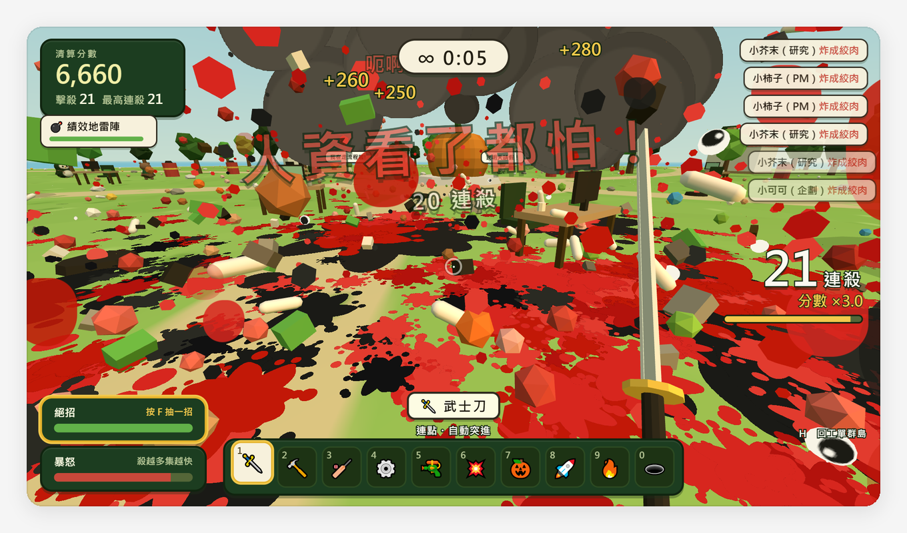</p>

### 會暫時取代手上武器的八招

這八招發動後，手上的武器會先收起來，時間到自動換回。

| 絕招 | 時間 | 怎麼用 |
|---|:---:|---|
| 🐲 怪獸變身 | 15 秒 | 左鍵揮爪大範圍撕碎，跳起來落地有震波 |
| 🏎️ 公司跑車 | 14 秒 | 自動往前衝，滑鼠轉向，<kbd>S</kbd> 煞車；撞到的會飛出去當保齡球 |
| 💪 充能臂砲 | 14 秒 | 按住左鍵蓄力，放開發射；滿蓄力會貫穿並爆炸 |
| 👐 怨念氣功波 | 14 秒 | 按住左鍵集氣，放出 5 秒的粗光柱，終點一路爆炸 |
| 💗 粉紅追魂斬 | 13 秒 | 左鍵丟出粉紅圓盤，會自己追人，切穿一隻再找下一隻 |
| 🤖 殺戮機器人 | 15 秒 | 按住左鍵雙管機槍左右狂掃，右鍵發射火箭 |
| ❄️ 寒冰劍 | 14 秒 | 揮劍凍成冰雕，再敲就碎；不敲 4–6 秒後也會自己碎 |
| 🌩️ 連鎖閃電 | 12 秒 | 按住左鍵放電，電會自己跳到下一隻，最多 10 隻 |

<p align="center">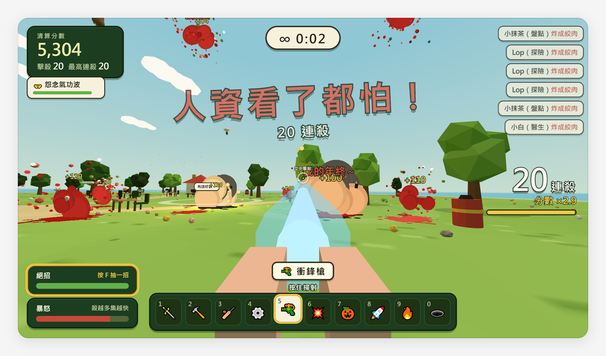</p>

<p align="center">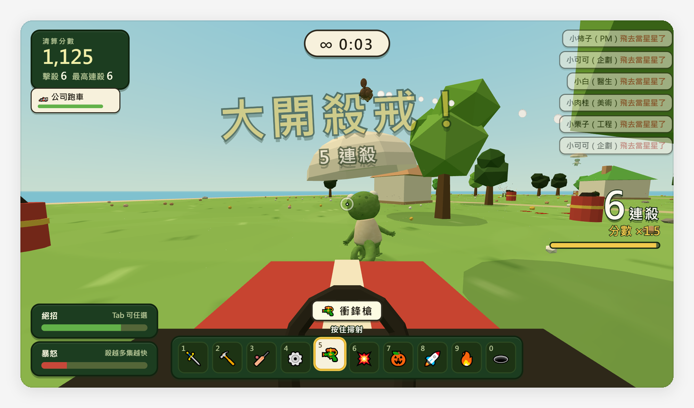</p>

<p align="center">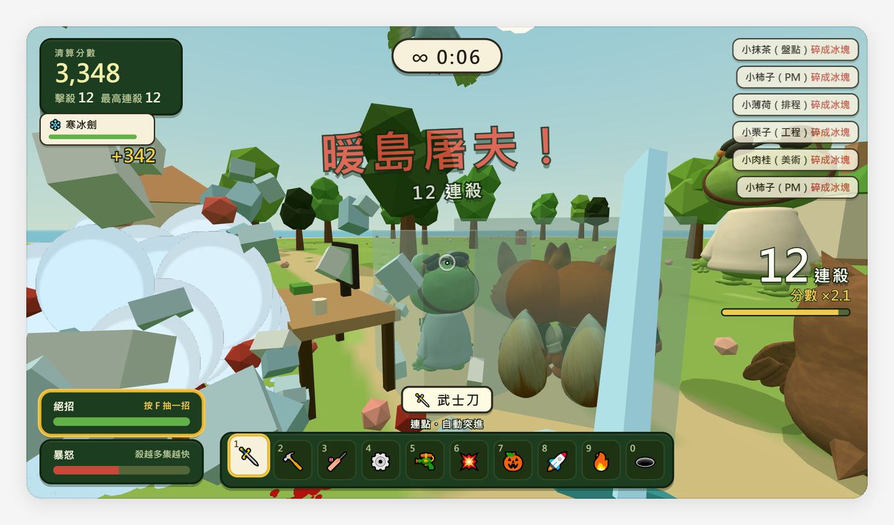</p>

### 召喚幫手的五招

叫出來之後它們自己會找人打，你可以繼續用手上的武器。

| 絕招 | 時間 | 效果 |
|---|:---:|---|
| 🐺 召喚野獸 | 14 秒 | 五隻狼追著咬 |
| 🐕 機器狗 | 18 秒 | 會咬人，背上每 1.5 秒發射一枚飛彈 |
| 🧟 死屍復活 | 16 秒 | 八隻喪屍島民從土裡爬出來，被咬死的也會變喪屍 |
| 🔧 自動砲塔 | 18 秒 | 在你面前架兩座機槍塔 |
| 🛸 無人機小隊 | 16 秒 | 三台在頭上繞，輪流轟炸 |

<p align="center">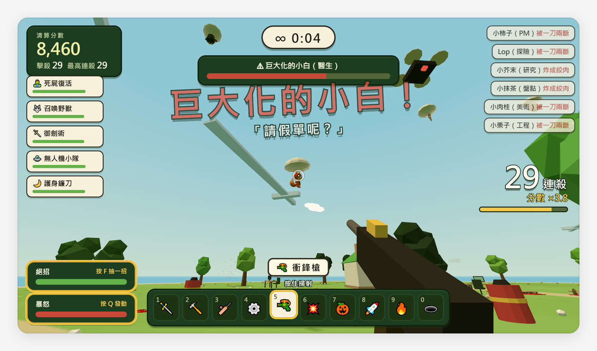</p>

<details>
<summary><b>其餘 15 招（增益、瞬發、整人類）</b></summary>

| 絕招 | 時間 | 效果 |
|---|:---:|---|
| 💨 極速狂奔 | 12 秒 | 速度 2.5 倍，撞到誰誰兩半 |
| 🌙 護身鐮刀 | 15 秒 | 三把鐮刀繞著你轉，靠近就割 |
| 🗡️ 御劍術 | 14 秒 | 六把飛劍自己找人砍 |
| ⚔️ 萬劍歸一 | 瞬發 | 54 把劍從天而降，最後一把巨劍收尾 |
| ⛈️ 落雷陣 | 瞬發 | 最近的 14 隻，一隻一道雷 |
| 🔵 彈跳泡泡球 | 12 秒 | 三顆大球滿場彈、會追人，壓到變肉餅 |
| 🍄 升官蘑菇 | 14 秒 | 變成巨人，用踩的 |
| ⚡ 雷公遙控器 | 10 秒 | 準星看誰就劈誰 |
| ⏱️ 下班打卡鐘 | 6 秒 | 時間暫停，砍完等時間恢復才一起倒 |
| ♾️ 無限火力 | 12 秒 | 所有武器零冷卻 |
| ☄️ 天降 KPI | 8 秒 | 隕石雨 |
| 📢 開會通知 | 8 秒 | 全員被拖到你面前集合 |
| 🤯 大頭症 | 16 秒 | 頭變超大，隨便打都爆頭 |
| 🎈 氦氣彈 | 瞬發 | 附近島民全部升天、越脹越大，然後啵 |
| ☢️ 全島資遣令 | 倒數 3 秒 | 全島清空 |

</details>

<p align="center">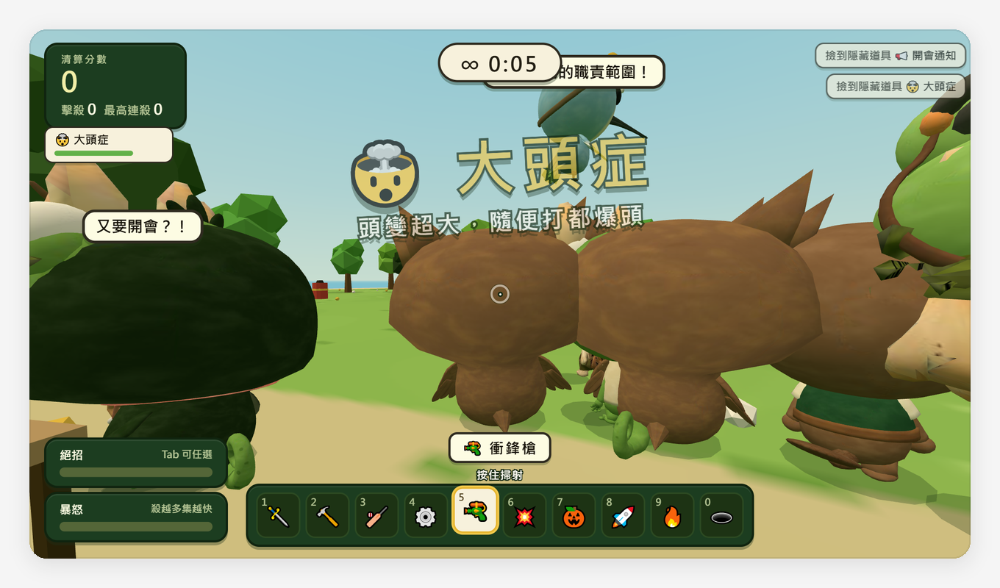</p>

## 😱 慘叫版

主選單有一顆「慘叫版」按鈕，遊戲中按 <kbd>C</kbd> 也能切換，預設是開的。開著的時候，每種死法會配不同的叫聲：

- **逃跑**：長聲尖叫，離你越近叫越勤。
- **被打飛**：越掉越低的慘叫。
- **被切**：叫到一半斷掉，接一聲咕嚕。
- **被拍扁**：一聲短吱。
- **著火**：邊跑邊叫。
- **機器人小麻糬**：一串往下掉的嗶嗶聲。

所有聲音（包含配樂）都是程式即時合成的，整個遊戲沒有任何一個音檔。嫌吵就按 <kbd>C</kbd> 關掉，會回到原本比較安靜的版本。

## 🥚 彩蛋

選單上只寫了「還有幾個彩蛋，自己找」。想自己找的人請跳過這段。

<details>
<summary><b>劇透：三個彩蛋的觸發方式</b></summary>

- **金色島民**：每隔 22–32 秒，會有一隻島民變成金色，跑得特別快。打死 +1500 分，並且原地掉一箱禮物。
- **南瓜神像**：走到島中央的大南瓜前面，對著它連踢三腳（右鍵）。南瓜神會生氣，從天上丟 26 顆爆炸南瓜下來。冷卻 45 秒。
- **叫老闆**：按 <kbd>B</kbd> 可以直接把巨大島民叫出來。冷卻 20 秒。

</details>

## 🧩 怎麼做出來的

整個遊戲是三個檔案：一個網頁、一包程式、一包素材。素材直接塞在程式檔裡，所以雙擊就能開，不用架伺服器。

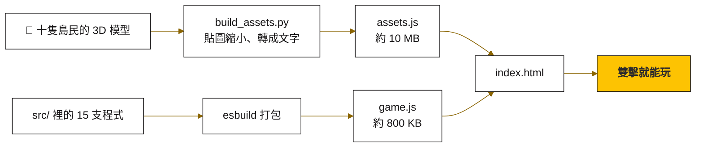

幾個做法上的取捨：

- **島民是現成的**：十隻都是已經綁好骨架、有走路動畫的 3D 角色，這裡只做了貼圖縮小（2048 → 1024）。
- **場景全部用程式生**：島、樹、房子、辦公桌都是程式碼拼出來的方塊和球，沒有另外的模型檔。
- **命中判定用算的**：每隻島民當成「頭一顆球、身體一顆球」來算有沒有打中，比真的去檢查模型表面快很多，幾十隻同場也算得過來。
- **血和肉塊共用一批物件**：畫面上的血滴、肉塊、眼珠是固定數量在輪流用，所以再怎麼噴都不會越跑越慢。
- **聲音全部即時合成**：用瀏覽器內建的 WebAudio 做出槍聲、爆炸、慘叫和配樂。

<details>
<summary><b>想自己改：開發指令與資料夾說明</b></summary>

需要先裝 [Node.js](https://nodejs.org/)。重新打包島民模型才需要 Python（含 Pillow）。

```bash
npm install
```

```bash
npm run build
```

打包完，`dist/game.js` 就是新的，重新整理網頁即可。

| 檔案 | 負責什麼 |
|---|---|
| `src/main.js` | 啟動、鍵盤滑鼠、玩家移動、計分、主迴圈 |
| `src/animals.js` | 島民的行為、受傷，以及十幾種死法 |
| `src/weapons.js` | 十把武器 |
| `src/powers.js` | 26 種絕招（變身、跑車、召喚物、劍陣、飛碟、鯨魚） |
| `src/items.js` | 禮物箱、另外 9 種道具、金色島民、彩蛋 |
| `src/weather.js` | 下雨、雷雨、閃電 |
| `src/fx.js` | 血、肉塊、煙、爆炸、浮動文字 |
| `src/audio.js` | 所有音效與配樂 |
| `src/world.js` | 島、樹、房子、辦公桌 |
| `src/ui.js` | 分數、連殺、選單、結算畫面 |
| `src/titles.js` | 等級、稱號、依最愛武器給的一句描述 |
| `src/limit.js` | 防沉迷：連玩兩場鎖 30 分鐘 |
| `src/isles.js` | 跟南瓜工單群島溝通：回傳成績、收排行榜 |
| `src/changelog.js` | 更新公告的內容，每出一版補一段 |
| `tools/build_assets.py` | 把島民模型轉成 `dist/assets.js` |
| `企劃.md` | 完整企劃 |

**測試用的後門**：網址後面加 `?debug`，可以在瀏覽器主控台用 `GAME` 這個物件操控遊戲，例如：

```js
GAME.start('free');     // 開一局無限發洩
GAME.give('beam');      // 直接拿到怨念氣功波
GAME.weather(1, 1);     // 強制雷雨
GAME.step(60);          // 快轉 60 格
GAME.resetLimit();      // 清掉防沉迷的鎖（?debug 預設不鎖，要測鎖請用 ?debug&limit）
```

</details>

<details>
<summary><b>名詞對照表</b></summary>

| 名詞 | 白話 | 在這裡的角色 |
|---|---|---|
| Three.js | 讓網頁能畫 3D 的工具 | 整個遊戲的畫面都靠它 |
| GLB | 一種 3D 模型檔，像 3D 版的 JPG | 島民原本的檔案格式 |
| esbuild | 把很多支程式合成一支的工具 | 產生 `game.js` |
| GitHub Pages | GitHub 免費幫你放網頁的服務 | 線上版的網址就是它給的 |
| 滑鼠鎖定 | 網頁把游標藏起來、只讀移動量 | 第一人稱轉視角需要它 |

</details>

## ❓ 常見問題

<details>
<summary><b>滑鼠動了但視角不會轉？</b></summary>

進遊戲後要先點一下畫面，瀏覽器才會把滑鼠交給遊戲。如果按了 <kbd>Esc</kbd> 跳出暫停畫面，點「繼續清算」就會重新鎖定。
</details>

<details>
<summary><b>線上版看起來是舊的，沒有新功能？</b></summary>

瀏覽器把舊檔案留著了。按 <kbd>Ctrl</kbd> + <kbd>F5</kbd> 強制重新整理。
</details>

<details>
<summary><b>沒有聲音？</b></summary>

瀏覽器規定要先有點擊才能出聲，所以要按下開始按鈕之後才會有音樂。另外檢查一下是不是按到 <kbd>M</kbd> 靜音了。
</details>

<details>
<summary><b>會卡嗎？需要多好的電腦？</b></summary>

在開發用的桌機上，54 隻島民加上雷雨、喪屍、飛劍、無人機同時開，實測 60 fps。只有內建顯示的文書機沒有測過，如果會卡，選「考績結算」會比「無限發洩」輕一點，因為時間短、島民還沒補到上限。
</details>

<details>
<summary><b>手機可以玩嗎？</b></summary>

目前不行，需要鍵盤和滑鼠。
</details>

<details>
<summary><b>分數會上傳嗎？</b></summary>

不會。最高分只存在你自己這台電腦的瀏覽器裡，沒有排行榜，也沒有蒐集任何資料。
</details>

## 🚧 還沒做好的地方

誠實列一下，免得你以為是自己的問題：

- **強度沒調過**：絕招的威力是估的。自動砲塔、御劍術、召喚野獸偏強，雷公遙控器和全島資遣令也可能太強。
- **評等門檻偏低**：加了絕招之後分數變好拿，SSS 的門檻還停在舊版。
- **主選單的按鍵說明會斷行**：字加太多了，在比較窄的螢幕上「靜音」兩個字會被拆開。
- **72 隻滿場的效能沒量到**：測試時絕招殺太快，湊不滿。

- [x] v1.0　十把武器、十種島民、兩種模式
- [x] v1.1　慘叫版、下雨與雷雨、禮物箱、彩蛋
- [x] v1.2　18 種新絕招、絕招槽、絕招選單、敵人加量
- [x] v1.3　排行榜、稱號、防沉迷、回工單群島、八個新絕招、更新公告
- [ ] 重新調整絕招強度與評等門檻
- [ ] 實機錄一段示範影片

## 授權與致謝

程式與島民角色為南瓜虛擬科技所有，做來給自己人紓壓用的。3D 繪圖使用 [Three.js](https://threejs.org/)（MIT 授權），打包使用 [esbuild](https://esbuild.github.io/)（MIT 授權）。

玩到哪招太強、太弱或太吵，歡迎開 [Issue](https://github.com/nanhong-byte/cozy-isle-payback/issues) 告訴我。

<sub>— 南瓜｜南瓜虛擬科技 · XR／3D／AI 工作流　·　最後更新 2026-11-16</sub>
